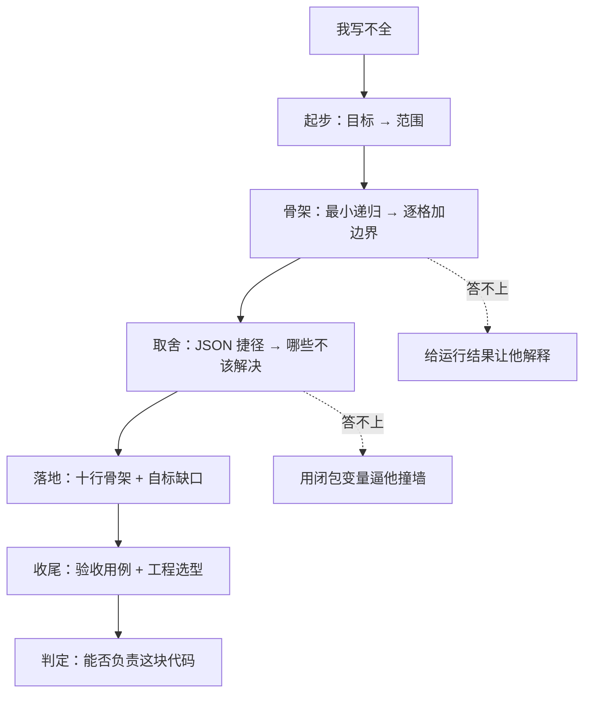

---
aliases:
  - 深拷贝面试对话实录
  - 面试官追问设计
tags:
  - 面试
  - JavaScript
  - 深拷贝
  - 场景题
created: 2026-11-12
---

# 深拷贝：一场没有止步于「我不会」的面试

> [!abstract] 这份文档是什么
> 一次模拟面试的完整对话实录。起点是候选人说出「完整版我现场不一定写得全」，终点是面试官给出判定。
> 面试官全程**没有降低最终难度**，也没有给提示，只做了一件事：把一道大题拆成一串一次只加一格的小问，让能力有机会逐层显形。
> 对话分八级，从「一句话就能答」起步，到写下代码、给出选型为止。每级后面有一个可折叠的「面试官视角」，写清这一问想探什么、哪句话得分、答不上来时降级到哪。

> [!warning] 先说两件不太好听的事
> 一、对话能救的不是「会不会」，而是**信息量**。选手若几轮全空，再细的台阶也变不出能力；开场那句「写不全」本身仍然是减分项，这套对话只是让它不至于变成终局判定。
> 二、**台阶是面试官搭的，不是候选人搭的**（见文末「这套设计的代价」）。顺着走完不等于能独立拆题，这一点必须在结论里单独扣回来。

## 台阶地图



---

## 第 1 级 · 先对齐目标

**候选人**：……所以完整版我现场不一定写得全。

**面试官**：好，先不谈完整版。你说说，深拷贝到底要解决什么问题？

**候选人**：改副本里嵌套的那层，原对象不受影响。

**面试官**：那浅拷贝差在哪？

**候选人**：只拷第一层，里面的对象还是同一个引用。

> [!note]- 面试官视角 · 第 1 级
> **想探什么**：不淘汰人，只让他开口。很多人卡在「写不出来」，是因为一上手就被「完整版」三个字压住了；先给一个必然答得上的问题，节奏才稳得住。
> **得分句**：用「引用」而不是「值」描述差异——这是后面所有边界的共同语言。
> **答不上来时**：给一个两层对象，问「改了 `b.c`，原来那个跟着变吗」。

---

## 第 2 级 · 先问范围，再动手

**面试官**：现在假设我真让你做，动手前你会先问我什么？挑一个最重要的。

**候选人**：覆盖范围。只处理普通对象和数组，还是要算上 Date、RegExp、Map、Set？我默认按「普通对象 + 数组 + 支持循环引用」来做，跟您预期不一致您纠正我。

**面试官**：只问一个，够了。那如果这是线上需求，不是考题呢？

**候选人**：那我不会从零写。先看 `structuredClone` 的语义和兼容性够不够，不够再上 `lodash.cloneDeep`；手写只在需要自定义拷贝语义时才划算。

> [!note]- 面试官视角 · 第 2 级
> **为什么放在写代码之前**：范围澄清比「目标」难一格，比「写骨架」轻一格，正好是过渡。
> **得分句**：「我默认按 X 做，不一致您纠正我」——带假设的反问，和空问「您想要什么」是两回事；「线上我不会自己写」把技术题翻译成了工程题。
> **失分信号**：如果候选人又滑回「我基础不扎实」，用一句轻的拉回即可，不要安慰。
> **答不上来时**：降级成二选一——「循环引用支不支持，你选一个，说理由」。

---

## 第 3 级 · 只要最小骨架

**面试官**：范围先按最窄的来。如果输入只有 `{ a: 1, b: { c: 2 } }`，你会怎么写？口述就行，别的都不用管。

**候选人**：一个函数，判空、非对象直接返回；是对象就新建一个容器，遍历 key，每个值递归回自己。

**面试官**：好。先记着这段，等下我一个个换输入。

> [!note]- 面试官视角 · 第 3 级
> **想探什么**：核心算法在不在。到这一步为止，任何准备过面试的人都该答得上，答不上就是真缺口。
> **为什么让他口述**：不写代码，把「写不全」的焦虑继续往后推，同时给下一级留一个可以逐格修改的靶子——**评审自己刚说的东西，比评审别人给的烂代码自然得多**。
> **答不上来时**：给半句提示「如果 `b` 还是对象，你会对 `b` 做什么」，只补递归这一环。

---

## 第 4 级 · 一次只加一个边界

**面试官**：就用你刚才那段。我一次换一个输入，你说会怎样、要改哪里。

**①** 如果 `obj.self = obj` 呢？

**候选人**：无限递归，爆栈。得记下已经拷过的对象，用 `WeakMap`，键是原对象、值是副本，进去先查。

**②** 那为什么用 `WeakMap` 不用 `Map`？

**候选人**：键本来就得是对象，而且 `WeakMap` 不阻止回收；这个函数跑完，缓存没必要一直留着。

**③** 好，下一个：`const x = {}; const o = { a: x, b: x }`，拷完 `o.a === o.b` 还成立吗？

**候选人**：……不成立。没有缓存的话 `x` 会被拷两次，两个字段变成两份。加上刚才那个 `WeakMap` 就顺带解决了。这个比爆栈麻烦，它不崩，只是改一处另一处不跟着变，数据静默不一致，很难复现。

**④** 换成 `new Date()` 呢？

**候选人**：会被当成普通对象遍历，拷出来是个空对象。得给特殊类型单独分支，判断用 `Object.prototype.toString.call` 比看 `constructor` 稳，后者能被改写，跨 iframe 也不可靠。

**⑤** 如果有个键是 `Symbol`？

**候选人**：`Object.keys` 拿不到，得换 `Reflect.ownKeys`，顺带把不可枚举属性也覆盖到。

**⑥** 最后一个：拷贝结果的原型链呢？

**候选人**：直接 `{}` 就丢了，`instanceof` 会不成立。用 `Object.create(Object.getPrototypeOf(o))` 建容器。

> [!note]- 面试官视角 · 第 4 级
> **为什么一次只加一个**：问「还有哪些边界」会变成背清单；逐个递输入，才看得出他是现场推演还是回忆答案。这是全场信息量最高的一级。
> **顺序是设计过的**：先「会崩」（循环引用）→ 再「不崩但更隐蔽」（共享引用）→ 再「类型 / 键 / 原型」这类语义丢失。难度和隐蔽性同步上升。
> **得分句**：「它不崩，只是悄悄不一致」——用可观测性判断严重程度，不是凭感觉排序；② 追 `WeakMap` 是为了看他能不能给自己的选择说理由，而不是只会报 API 名。
> **答不上来时**：从「找错」降到「验证」——直接给结果让他解释，例如「`copy.a === copy.b` 是 false，你说是哪一步造成的」。

---

## 第 5 级 · 有人走捷径

**面试官**：上面这些分支挺啰嗦。有人说 `JSON.parse(JSON.stringify(obj))` 一行就够，你怎么看？

**候选人**：会丢不少东西，undefined、函数、Symbol 直接消失，NaN 变 null，Date 变字符串，Map、Set 变空对象，循环引用直接抛……

**面试官**：打断一下，别列清单。挑两个会造成线上事故的，说后果。

**候选人**：嗯……我重说。一个是 Date 变字符串：下游拿它做时间比较或排序，类型已经悄悄变了，不报错，结果慢慢偏掉。另一个是循环引用抛错：如果这段在批量同步里，一条数据带自引用会中断整批，而不是跳过单条。至于丢 undefined，很多时候其实无所谓。

> [!note]- 面试官视角 · 第 5 级
> **为什么现在才问**：此时候选人手里已经有第 4 级攒出来的骨架，才有对照物去判断「这行捷径到底省掉了什么」。放最前面就只是考记忆。
> **为什么要打断**：一口气背六条坑，是准备过的痕迹，不是理解。制造一次轻微压力，看他能不能重新组织。
> **得分句**：「丢 undefined 很多时候无所谓」——主动承认有些坑不重要，比列全更像做过取舍的人。
> **答不上来时**：给具体场景——「一个带 Date 字段的订单，序列化回来后哪行代码先出错」。

---

## 第 6 级 · 哪些东西根本不该解决

**面试官**：那函数怎么拷？

**候选人**：不拷，共享引用。函数绑着闭包和词法环境，复制函数体不等于复制函数。

**面试官**：业务方坚持要一份「独立的函数」呢？

**候选人**：……可以用 `new Function` 把 `toString()` 拆出参数和函数体重建，不过——不，这个我不推荐。闭包变量全丢，箭头函数没有 `prototype`，原生函数只有 `[native code]`，默认参数、解构、async 全挂，CSP 下这类动态执行还会被禁。我会先反问业务方要「独立」到底解决什么：如果是为了可序列化或跨线程传递，那需求本身不成立，应该传数据加函数标识。这个我会写进接口文档，不偷偷糊一个。

**面试官**：再往前一步，class 实例和私有字段、DOM 节点呢？

**候选人**：这些我会在接口上直接写「不支持」。用 `Object.create` 拿原型，得到的是个长得像但没走构造、私有字段也不在的实例——与其悄悄产出个半残对象，不如让调用方一开始就别传进来。

> [!note]- 面试官视角 · 第 6 级
> **为什么放在最后**：前五级考 JS，这一级考协作边界。敢说「不」、能把技术问题回推成需求问题，比多写两个分支难得，也最容易在压力下崩。
> **得分句**：「可以用 `new Function`……不过，不，这个我不推荐」——自我纠偏比一次答对更可信；「不偷偷糊一个」把缺陷变成了契约。
> **答不上来时**：给一个具体闭包——「这个函数引用了外层的 `token`，拷过去之后 `token` 从哪来」，让他自己撞墙。

---

## 第 7 级 · 此时才落代码

**面试官**：好，现在把刚才这些写下来，十行左右就行，不用全。

```js
// 候选人手写
function clone(o, seen = new WeakMap()) {
    if (o === null || typeof o !== 'object') return o;
    if (seen.has(o)) return seen.get(o);
    const t = Object.prototype.toString.call(o);
    if (t === '[object Date]') return new Date(o);
    if (t === '[object RegExp]') return new RegExp(o.source, o.flags);
    const r = Array.isArray(o) ? [] : Object.create(Object.getPrototypeOf(o));
    seen.set(o, r);
    Reflect.ownKeys(o).forEach(k => { r[k] = clone(o[k], seen); });
    return r;
}
```

**面试官**：跟第 3 级你口述的那三行比，多出来的都是刚才聊过的？

**候选人**：对，缓存、类型分支、键的遍历方式、原型，一级一级加的。没写的部分我也说一下：Map、Set 要补两个分支，且得先 `cache.set` 再遍历，否则 Set 自引用会挂；属性描述符和 getter 没保留；递归还有爆栈风险，超大对象要改成迭代加显式栈。这几处是缺口，我不假装它完备。

> [!note]- 面试官视角 · 第 7 级
> **为什么现在才要代码**：这段实现是前六级**累加**出来的，不是凭空默写。难度一点没降，但每一步都有铺垫，所以写不出来这件事本身就没发生。
> **得分句**：「这几处是缺口，我不假装它完备」——主动标缺口比代码本身值钱。
> **要点破的事**：开场那句「写不全」不是能力上限，是**题目没被拆开时**的自我预判。面试里真正的失分往往来自没拆题，而不是不会写。
> **答不上来时**：允许只写前三行（判空 + 缓存 + 递归），类型分支口述。

---

## 第 8 级 · 验收与选型

**面试官**：最后两个：怎么验收它？线上真要用，你选什么？

**候选人**：验收跑七条——嵌套层修改互不影响、`obj.self = obj` 不爆栈且 `copy.self === copy`、共享引用保持同一份、Date 和 RegExp 类型不丢、Symbol 键、原型链 `instanceof` 成立、大对象不爆栈。

**候选人**：选型上现代环境优先 `structuredClone`，原生支持循环引用和 Map / Set / Date / RegExp / TypedArray，但它会丢原型链，不支持函数和 DOM，Proxy 会抛 `DataCloneError`；老环境或要自定义语义用 `lodash.cloneDeep`。再往上其实该问一句：为什么每次都要 O(n) 全量拷？很多场景用不可变数据或 immer 根本不需要深拷贝。

> [!note]- 面试官视角 · 第 8 级
> **想探什么**：有没有验收意识，以及能不能从「怎么实现」跳到「要不要实现」。
> **得分句**：最后那句反问，是全场唯一一次候选人主动改了题目本身。
> **答不上来时**：给一个结果让他解释——「`structuredClone` 拷一个 class 实例，`instanceof` 还成立吗」。

---

## 面试官的结论（不念给候选人听）

> [!success] 拿到的信号
> 用「引用」描述目标（1）、带默认假设澄清范围（2）、核心递归在（3）、逐格推演并按可观测性排严重程度（4）、被打断后重组与取舍（5）、敢否定并回推需求（6）、主动标注实现缺口（7）、验收与选型（8）。
> 这八项都不是「会写深拷贝」，但都指向「能不能负责这块代码」。

> [!danger] 实打实的减分项，别替他抹掉
> 1. 开场那句「写不全」如果停在那里，本轮信息量为零——是后面的追问给了通道，不是这句话本身有价值。
> 2. 第 4 级里「共享引用」和「原型链」两格，是面试官递了输入他才推出来的，不是自己先列出来的。
> 3. Map / Set 分支最终没写，只是口述；递归爆栈停留在「知道」，没有处理。
> 4. 属性描述符、getter 求值时机、TypedArray 这些深水区是靠主动声明绕过去的，不是答上来的。

> [!warning] 这套设计的代价
> 台阶越细，越要防一件事：**结构是面试官搭的，不是候选人搭的**。他顺着走完了，说明推演能力在；但换个要求「自己定义问题」的岗位，就得补一轮——不给任何提示，让他自己列出要考虑的边界清单，看他能不能独立搭出这八级。
> 少了这一轮，这套对话就有滑向变相放水的风险：看着聊得很顺，其实每一格的方向都是面试官给的。

> [!note] 判定
> **业务向中高级岗位：给过**，判的是「能不能负责这块代码」，不是「能不能默写完整实现」。
> **偏基础库 / 引擎向岗位：存疑，需加一轮无提示的自拆题 + 真写。** 那类岗位要的正是他绕过去的深水区。
> 换句话说，这套对话改变的是**判定维度**，既不是难度，也不是分数。

---

## 追问工具箱

| 级别 | 这一问 | 比上一级多了什么 | 答不上来时降级到 |
| --- | --- | --- | --- |
| 1 | 深拷贝解决什么 / 浅拷贝差在哪 | 起点，一句话 | 给两层对象，问改了变不变 |
| 2 | 动手前先问哪一个问题 | 需求澄清 | 二选一 + 说理由 |
| 3 | 只有两层对象，口述怎么写 | 核心算法 | 补半句递归提示 |
| 4 | 一次换一个输入，逐格加边界 | 推演与排严重程度 | 给运行结果让他解释 |
| 5 | 打断清单，挑两个说线上后果 | 抗压重组、取舍 | 定位「哪行代码先出错」 |
| 6 | 函数怎么拷 / 业务方坚持呢 / class 呢 | 敢说不、回推需求 | 用闭包变量逼他撞墙 |
| 7 | 写十行骨架并自标缺口 | 从口述落到代码 | 只写前三行，其余口述 |
| 8 | 怎么验收 / 线上选什么 | 从实现跳到要不要实现 | 解释一个具体运行结果 |

> [!tip] 面试官自查
> - [ ] 一次只加一个变量，没有连问、没有一次抛五个边界
> - [ ] 前两级不淘汰人，只让候选人开口
> - [ ] 每一级只比上一级难一格，且都能接在上一级的结论上
> - [ ] 全程没有「你再想想」这类送分提示；降级只降表达难度，不降判断难度
> - [ ] 结论里保留了真实减分项，没有把「顺着走完」当成独立拆题能力
> - [ ] 没有把「聊得好」等同于「会写」

---

> [!quote] 给候选人的一句话
> 决定结果的不是最后那 11 行代码，是第 4 级的「它不崩，只是悄悄不一致」和第 6 级那句「不，这个我不推荐」。把「我写不全」换成「我们先把它拆开」确实更好听——但它只在你真能一格格走下去时才成立，否则面试官递到第二个输入就见底了。
